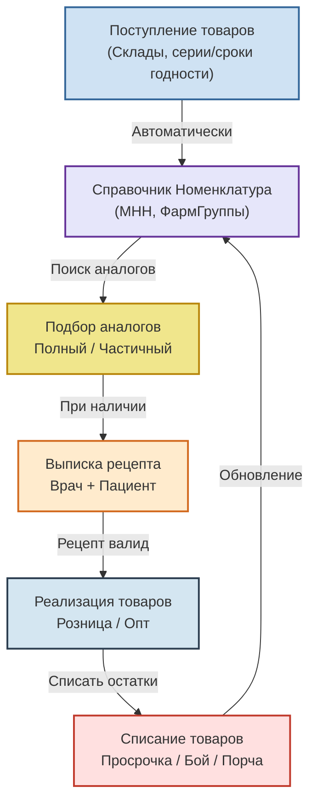

# Учёт в аптеке — 1C:Enterprise 8.3

**Управляемое приложение для автоматизации аптечной розниці и опта.**

Система охватывает полный цикл работы аптеки: от приема лекарственных препаратов с контролем сроков годности и рецептов до реализации и списания товаров.

---

## Бизнес-процессы (Mermaid схема)



### Описание потока:

1. **Поступление товаров** (`ПоступлениеТоваров`) — приемка лекарств с указанием:
   - Склада (Основной, Торговый зал, Холодильная камера, Карантин)
   - Серийного номера и срока годности
   - Контрагента-поставщика

2. **Справочник Номенклатура** — основной реестр лекарств с атрибутами:
   - МНН (Medical Drug Number)
   - Фармакотерапевтическая группа
   - Требует рецепт (boolean)
   - Атрибут `Аналоги` — tabular section для поиска аналогов препаратов
   - Типы аналогов: **Полный** (полностью заменяемый) и **Частичный** (заменяет часть характеристик)

3. **Выписка и контроль рецептов** (`Рецепт`):
   - Регистрация врачом с указанием пациента
   - Статусы: **Выписан** → **Отпущен** → **Аннулирован**
   - Контроль: нельзя реализовать препарат с `ТребуетРецепт=true`, если нет документа `Рецепт` со статусом `Отпущен`

4. **Реализация и списание** — основные торговые документы:
   - `РеализацияТоваров` — продажа с учетом типа (Розница/Опт), контрагента и рабочего места
   - `СписаниеТоваров` — списание с причиной: Просрочка, Боя, Порча
   - Оба документа обновляют остатки на складах через регистры накопления

---


## Справочники и перечисления

| Категория | Наименование | Ключевые атрибуты |
|-----------|-------------|-------------------|
| **Catalogs** | Номенклатура | Иерархия (2 уровня), МНН, ФармаГруппа, ТребуетРецепт, Аналоги |
| | ФармГруппы | Фармакотерапевтические группы препаратов |
| | Склады | Типы: Основной/ТорговыйЗал/ХолодильнаяКамера/Карантин; Ответственный контрагент |
| | Контрагенты | ИНН, страна, город, адрес ЭП, телефон |
| | МНН | Классификатор медицинских препаратов |
| **Enums** | ТипыРеализации | Розница, Опт |
| | СтатусыРецептов | Выписан → Отпущен → Аннулирован |
| | ПричиныСписания | Просрочка, Боя, Порча |
| | ТипыСкладов | ОсновнойСклад, ТорговыйЗал, ХолодильнаяКамера, Карантин |
| | ТипыАналогов | Полный, Частичный |


---

## Роли и права доступа

Конфигурация включает настраиваемые роли через метаданные `Roles/*.xml`. Основные роли:

| Роль | Описание | Типичные права |
|------|----------|----------------|
| **Администратор** | Полный доступ ко всей системе | Управление пользователями, настройка конфигурации, администрирование базы |
| **Провизор** | Работа с ассортиментом и запасами | Приемка товаров, списание с причиной, просмотр остатков, подбор аналогов |
| **Кассир** | Проведение продаж | Реализация товаров, работа с покупателями, поиск аналогов (только для Лекарств без рецепта) |
| **Врач** | Выписка рецептов | Создание документов `Рецепт`, назначение препаратов и пациентов |

**Минимальные базовые права (БазовыеПраваБСП)** — предоставляются всем пользователям кроме внешних, включают базовые операции чтения и записи объектов конфигурации.

Каждая роль определяется в отдельном файле `Roles/<Название>.xml` с указанием UUID и набора прав на объекты конфигурации.

---


## Технические детали

- **Платформа**: 1С:Предприяе 8.3, управляемое приложение
- **Режим работы**: Клиент-сервер или толстый клиент
- **База данных**: Встроенная HDB или внешний SQL Server
- **Форматы данных**: XML-метаданные (Configuration.xml), документы и справочники хранится в формате 1C:Binary
- **Интеграция**: Возможность обмена данными через внешние службы и веб-сервисы

---

## Структура репозитория

```
1c-pharmacy-accounting/
├── Configuration.xml   # Основной метафайл конфигурации
├── Catalogs/           # Справочники (Номенклатура, ФармГруппы, Склады, Контрагенты)
├── Documents/          # Документы (Рецепт, РеализацияТоваров, ПоступлениеТоваров, СписаниеТоваров)
├── Enums/              # Перечисления (ТипыРеализации, СтатусыРецептов и др.)
├── Roles/              # Роли пользователей (Администратор, Провизор, Кассир)
└── README.md           # Эта документация
```
